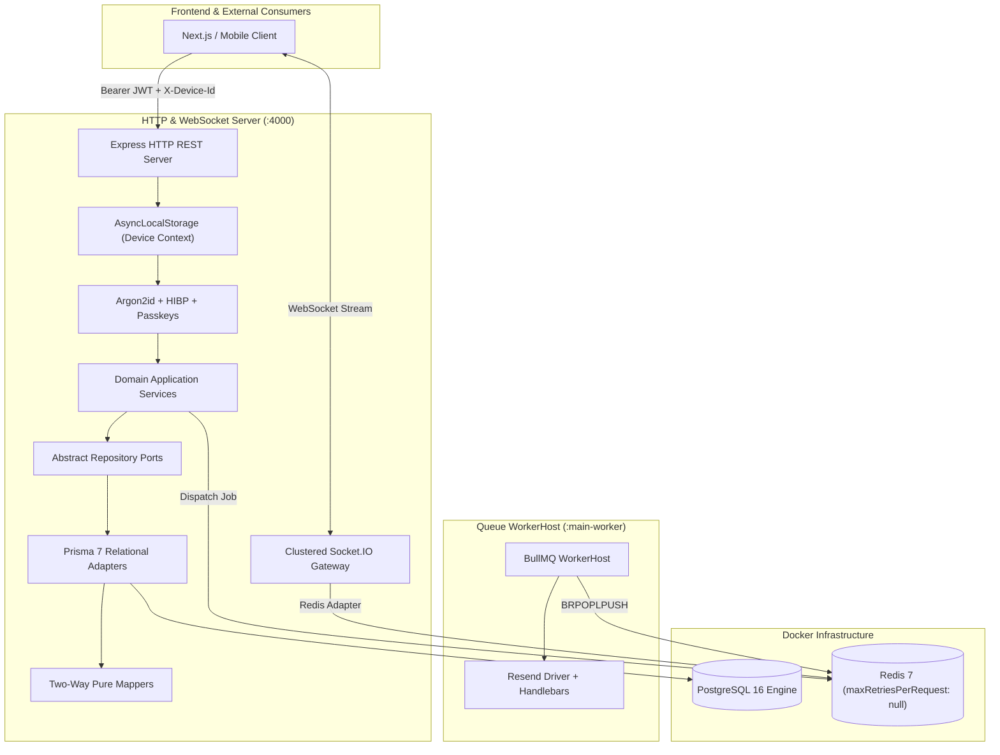

# Fanaye Technologies Enterprise Backend Nest.js Boilerplate (2026 Edition)
> **The High-Assurance Hexagonal Persistence & Asynchronous Processing Engine for Enterprise SaaS Platforms**  
> *NestJS 11 + Prisma 7 (PostgreSQL 16) + BullMQ (Redis 7) + Argon2id IAM Defense + Clustered WebSockets + Living Memory*

---

[](https://nodejs.org/)
[](https://nestjs.com/)
[](https://www.prisma.io/)
[](https://www.postgresql.org/)
[](https://bullmq.io/)
[](https://redis.io/)
[](#5-enterprise-iam-defense-in-depth)
[](https://marketplace.visualstudio.com/items?itemName=natinaelsamuel.memo-living-memory)

---

## Author & Governance

- **Principal Architect & Author**: **Natinael Samuel**
- **Edition**: 2026 Enterprise Release
- **Organization**: **Fanaye Technologies**
- **Direct Contact**: [`afritioalberts1216@gmail.com`](mailto:afritioalberts1216@gmail.com)
- **Phone / Telegram**: `+251904161978`
- **Living Memory Extension**: [Memo - Living Memory (VS Code Marketplace)](https://marketplace.visualstudio.com/items?itemName=natinaelsamuel.memo-living-memory)

---

## Table of Contents

1. [Executive Summary & Architectural Invariants](#1-executive-summary--architectural-invariants)
2. [High-Level System Architecture](#2-high-level-system-architecture)
3. [Project Directory Map](#3-project-directory-map)
4. [Hexagonal Persistence (Ports & Adapters)](#4-hexagonal-persistence-ports--adapters)
5. [Dual-Process Backend & WorkerHost Isolation](#5-dual-process-backend--workerhost-isolation)
6. [Enterprise IAM & Defense-in-Depth](#6-enterprise-iam--defense-in-depth)
7. [Clustered WebSockets with Redis Adapter](#7-clustered-websockets-with-redis-adapter)
8. [The Five Backend Agent Skills](#8-the-five-backend-agent-skills)
9. [Relational Resource Generator (Hygen)](#9-relational-resource-generator-hygen)
10. [Memo - Living Memory VS Code Extension](#10-memo---living-memory-vs-code-extension)
11. [Quick Start & Developer Onboarding](#11-quick-start--developer-onboarding)
12. [Testing Accounts & Seed Ledger](#12-testing-accounts--seed-ledger)
13. [Docker & Container Orchestration](#13-docker--container-orchestration)
14. [Complete Command Reference Matrix](#14-complete-command-reference-matrix)

---

## 1. Executive Summary & Architectural Invariants

The **Fanaye Technologies Enterprise Backend Nest.js Boilerplate (2026 Edition)** provides an industrial-grade foundation for high-assurance enterprise APIs. Designed to handle mission-critical financial transactions, asynchronous job processing, and defense-in-depth identity management, it enforces four non-negotiable architectural invariants:

1. **Hexagonal Persistence (Ports & Adapters)**:
   - Domain entities (`src/*/domain/*.ts`) must **NEVER** import `@prisma/client`.
   - Repository ports are abstract TypeScript classes used as NestJS injection tokens.
   - All transformations between Prisma models and domain entities occur exclusively in dedicated pure two-way mappers (`*-prisma.mapper.ts`).
2. **Dual-Process Isolation**:
   - `src/main.ts` serves the Express HTTP REST API and WebSocket gateway on port 4000.
   - `src/main-worker.ts` runs a dedicated BullMQ background worker application context.
   - Never run heavy asynchronous processing directly inside HTTP controllers.
3. **Redis Connection Invariant**:
   - BullMQ relies on blocking Redis commands. All queue and worker connection configs MUST specify `maxRetriesPerRequest: null`.
4. **Enterprise IAM Defense-in-Depth**:
   - Passwords are encrypted using **Argon2id** (`memoryCost: 19456, timeCost: 2, parallelism: 1`).
   - Legacy bcrypt hashes (`$2a$`, `$2b$`) automatically and transparently rehash to Argon2id upon successful login.
   - All passwords pass Have I Been Pwned (HIBP) k-anonymity breach verification (with network fail-open fallback).
   - Multi-device sessions are tracked via Node.js `AsyncLocalStorage` (`requestDeviceContext`).

---

## 2. High-Level System Architecture

```
                                  FANAYE ENTERPRISE BACKEND
                              (Dual-Process Hexagonal Engine)
                                             │
             ┌───────────────────────────────┴───────────────────────────────┐
             ▼                                                               ▼
   HTTP / WebSocket Process                                      Standalone Worker Process
    (src/main.ts : Port 4000)                                      (src/main-worker.ts)
  ├── Express REST API                                            ├── Standalone Nest Application Context
  ├── Clustered Socket.IO Gateway                                 ├── BullMQ WorkerHost
  ├── AsyncLocalStorage Request Context                           ├── MailProcessor (Resend Driver)
  ├── Argon2id IAM + HIBP Breach Guard                            ├── Handlebars Email Templating
  ├── WebAuthn Passkeys & TOTP 2FA                                └── Isolated Error & Retry Logic
  └── Hexagonal Domain Slices
             │                                                               │
             └───────────────────────┬───────────────────────────────────────┘
                                     │
                                     ▼
                   ┌───────────────────────────────────┐
                   │ Infrastructure Services (Docker)  │
                   │  ├── PostgreSQL 16 (Port 5432)    │
                   │  └── Redis 7 (Port 6379)          │
                   └───────────────────────────────────┘
```



---

## 3. Project Directory Map

```
Fanaye Technologies Enterprise Backend Nest.js Boilerplate/
├── .agents/skills/               # Living Agentic AI Skills Ecosystem
│   ├── 3-create-domain-slice/    # Full-stack DDD vertical slice scaffolding playbook
│   ├── 4-hexagonal-persistence/  # Prisma 7 domain decoupling playbook
│   ├── 5-enterprise-iam-defense/ # Argon2id, HIBP & WebAuthn security playbook
│   ├── 6-async-bullmq-worker/    # Standalone BullMQ WorkerHost playbook
│   └── 7-safe-db-migration/     # Safe database migration & data-loss guardrails
│
├── .vscode/                      # IDE Configuration & Workspace Recommendations
│   ├── extensions.json           # natinaelsamuel.memo-living-memory recommendation
│   └── settings.json             # Formatter and memo settings
│
├── memory/                       # Living Architectural Memory & Engineering Audit
│   ├── development_guidelines.md # Core non-negotiable development rules
│   ├── master_architecture.md    # High-level system architecture specification
│   ├── edit_log.md               # Reverse-chronological immutable edit history
│   └── progress_log.md           # Milestone tracker & Technical Decisions Log (TDL)
│
├── prisma/                       # Database Schema, Migrations & Seed Script
│   ├── schema.prisma             # PostgreSQL schema with Users, Sessions, Passkeys, Transactions
│   └── seed.ts                   # Idempotent enterprise sample records & financial ledger
│
├── scripts/                      # Operational & Tooling Automation
│   └── setup-memo.js             # Automated install & initialization of Memo Living Memory
│
├── src/                          # NestJS 11 Source Code
│   ├── main.ts                   # HTTP REST API & WebSockets server entry point (:4000)
│   ├── main-worker.ts            # Dedicated BullMQ background job consumer entry point
│   ├── app.module.ts             # Root application module wiring
│   ├── auth/                     # Argon2id hashing, HIBP breach check, TOTP 2FA, Passkeys
│   ├── database/                 # PrismaService with native pg pool adapter
│   ├── mail/                     # BullMQ MailProcessor & Resend email driver
│   ├── notifications/            # Clustered RedisIoAdapter & Socket.IO gateway
│   ├── session/                  # AsyncLocalStorage requestDeviceContext
│   ├── users/                    # Hexagonal users domain slice (ports, mappers, adapter)
│   └── transactions/             # Hexagonal financial ledger slice with KPI metrics
│
├── _templates/                   # Hygen automated relational generator
├── Dockerfile                    # Multi-stage Alpine container definition
├── docker-compose.yml            # PostgreSQL 16 + Redis 7 infrastructure orchestration
├── nest-cli.json                 # NestJS compilation configuration
├── package.json                  # Standalone backend npm dependencies and scripts
├── tsconfig.json                 # TypeScript compiler configuration
└── README.md                     # Master architectural documentation
```

---

## 4. Hexagonal Persistence (Ports & Adapters)

To ensure that core domain logic remains 100% testable and decoupled from database ORMs, this boilerplate implements strict Hexagonal Architecture:

```
[ Domain Model (User) ]
       ▲
       │ implements
[ Abstract Repository Port (UserRepository) ]
       ▲
       │ implements
[ Concrete Relational Adapter (UserPrismaRepository) ]
       │ uses
[ Pure Two-Way Mapper (UserPrismaMapper) ]
       │ transforms
[ Prisma ORM Model (Prisma.User) ]
       │ executes
[ PostgreSQL 16 Database ]
```

### Key Components of a Domain Slice:
1. **Domain Entity (`src/*/domain/*.ts`)**:
   A pure TypeScript class representing enterprise business rules. Contains **zero ORM decorators and zero imports from `@prisma/client`**.
2. **Repository Port (`src/*/infrastructure/persistence/*.repository.ts`)**:
   An abstract TypeScript class defining the contract for database access:
   ```typescript
   export abstract class UserRepository {
     abstract create(data: CreateUserDto): Promise<User>;
     abstract findById(id: string): Promise<User | null>;
     abstract findByEmail(email: string): Promise<User | null>;
   }
   ```
3. **Pure Two-Way Mapper (`src/*/infrastructure/persistence/relational/mappers/*-prisma.mapper.ts`)**:
   Pure static methods mapping to and from the database representation:
   ```typescript
   export class UserPrismaMapper {
     static toDomain(raw: PrismaUser): User { ... }
     static toPersistence(entity: Partial<User>): Prisma.UserCreateInput { ... }
   }
   ```
4. **Relational Repository Adapter (`src/*/infrastructure/persistence/relational/repositories/*-prisma.repository.ts`)**:
   The concrete NestJS provider injecting `PrismaService` and implementing the abstract port.

---

## 5. Dual-Process Backend & WorkerHost Isolation

Standard monolithic Node.js backends suffer from latency degradation when executing CPU-heavy tasks or processing large batches of emails inside the same thread that handles HTTP requests.

This boilerplate enforces **Dual-Process Isolation**:

- **Express HTTP Server (`src/main.ts`)**:
  Handles synchronous REST requests, JWT validation, and Socket.IO WebSocket connections on port `4000`.
- **Standalone Queue Worker (`src/main-worker.ts`)**:
  Boots an independent NestJS application context with no HTTP listener. It processes background jobs dispatched to BullMQ:
  ```typescript
  // src/main-worker.ts
  async function bootstrapWorker() {
    const logger = new Logger('WorkerBootstrap');
    const app = await NestFactory.createApplicationContext(AppModule, {
      logger: ['error', 'warn', 'log'],
    });
    logger.log('Fanaye BullMQ Worker Host listening for queue dispatches...');
  }
  bootstrapWorker();
  ```

### Redis Connection Invariant
BullMQ requires blocking commands (`BRPOPLPUSH`). Every Redis connection configuration declares:
```typescript
connection: {
  host: process.env.REDIS_HOST || 'localhost',
  port: Number(process.env.REDIS_PORT) || 6379,
  maxRetriesPerRequest: null, // MANDATORY INVARIANT FOR BULLMQ
  enableReadyCheck: false,
}
```

---

## 6. Enterprise IAM & Defense-in-Depth

### 1. Argon2id Password Hashing
Passwords are cryptographic hashes created with the OWASP-recommended Argon2id algorithm:
- `memoryCost: 19456` (19 MiB)
- `timeCost: 2` iterations
- `parallelism: 1` thread

### 2. Transparent Bcrypt Migration
When a user with a legacy bcrypt hash (`$2a$`, `$2b$`) logs in successfully, the authentication service verifies the password against bcrypt and automatically re-hashes it with Argon2id in the background.

### 3. Have I Been Pwned (HIBP) k-Anonymity Check
Before registering a user or changing a password, the system generates a SHA-1 hash and sends only the first 5 hexadecimal characters to the HIBP API. The API fails open if the network is unavailable.

### 4. AsyncLocalStorage Multi-Device Telemetry
Every incoming HTTP request passes through an Express interceptor that initializes a thread-local context via Node.js `AsyncLocalStorage`:
```typescript
requestDeviceContext.run({
  deviceId: req.headers['x-device-id'] || randomUUID(),
  userAgent: req.headers['user-agent'] || 'Unknown',
  ipAddress: req.ip,
}, () => next());
```
Any service can access device telemetry without passing parameters through controller layers.

---

## 7. Clustered WebSockets with Redis Adapter

Real-time notifications and ledger updates use Socket.IO backed by the `@socket.io/redis-adapter`.
- Clustered across multiple API instances seamlessly.
- Automatically handles Redis TLS in cloud environments (AWS ElastiCache, Upstash, Redis Cloud).

---

## 8. The Five Backend Agent Skills

Located under `.agents/skills/`, these playbooks guide AI coding assistants:

| Skill | Directory | Core Purpose |
| :--- | :--- | :--- |
| **`3-create-domain-slice`** | `.agents/skills/3-create-domain-slice/` | Scaffolds synchronized DDD vertical slices via Hygen. |
| **`4-hexagonal-persistence`** | `.agents/skills/4-hexagonal-persistence/` | Decouples Prisma 7 from domain logic via abstract ports and pure mappers. |
| **`5-enterprise-iam-defense`** | `.agents/skills/5-enterprise-iam-defense/` | Argon2id, HIBP k-anonymity, 2FA TOTP, WebAuthn Passkeys, session tracking. |
| **`6-async-bullmq-worker`** | `.agents/skills/6-async-bullmq-worker/` | Standalone BullMQ WorkerHost, Redis resilience (`maxRetriesPerRequest: null`). |
| **`7-safe-db-migration`** | `.agents/skills/7-safe-db-migration/` | Non-destructive schema evolution, accidental data-loss prevention. |

---

## 9. Relational Resource Generator (Hygen)

Scaffold a complete, production-ready Hexagonal domain slice in seconds:

```bash
npm run generate:resource
```

The generator prompts for the entity name (e.g. `invoice`) and automatically generates:
1. `src/invoices/domain/invoice.ts` (Pure domain entity)
2. `src/invoices/dto/create-invoice.dto.ts` (Validation DTO)
3. `src/invoices/infrastructure/persistence/invoice.repository.ts` (Abstract repository port)
4. `src/invoices/infrastructure/persistence/relational/mappers/invoice-prisma.mapper.ts` (Two-way mapper)
5. `src/invoices/infrastructure/persistence/relational/repositories/invoice-prisma.repository.ts` (Prisma adapter)
6. `src/invoices/invoices.service.ts` (Domain application service)
7. `src/invoices/invoices.controller.ts` (REST controller)
8. `src/invoices/invoices.module.ts` (NestJS module)

---

## 10. Memo - Living Memory VS Code Extension

This boilerplate natively integrates with **Memo - Living Memory**, created by **Natinael Samuel**:
- **Marketplace Hub**: [natinaelsamuel.memo-living-memory](https://marketplace.visualstudio.com/items?itemName=natinaelsamuel.memo-living-memory)

### Automatic Setup
The extension is integrated at multiple levels:
1. **Workspace Recommendations (`.vscode/extensions.json`)**:
   Opening this project in VS Code or Cursor automatically suggests installing `natinaelsamuel.memo-living-memory` with a 1-click prompt.
2. **Automated Setup Hook (`npm run setup:memo`)**:
   Running `npm install` automatically triggers `node scripts/setup-memo.js`, which detects your VS Code / Cursor CLI and silently installs and configures the extension.
3. **Workspace Configuration (`.vscode/settings.json`)**:
   Pre-configures `"memo.memoryPath": "./memory"`, enabling instant synchronization of guidelines, progress logs, and immutable edit history.

---

## 11. Quick Start & Developer Onboarding

### System Prerequisites
- **Node.js**: `v20.x` or `v22.x` (LTS recommended)
- **npm**: `v10.x` or higher
- **Docker & Docker Compose**: For local PostgreSQL 16 and Redis 7 containers

### Step 1: Start Infrastructure Containers
```bash
# Starts PostgreSQL 16 (port 5432) and Redis 7 (port 6379)
docker compose up -d
```

### Step 2: Install Dependencies & Initialize Memo Extension
```bash
npm install
```
*(This automatically runs `npm run setup:memo` to verify your living memory environment and install the extension).*

### Step 3: Run Database Migrations & Seed Records
```bash
# Generate Prisma 7 Client
npm run prisma:generate

# Execute relational migrations
npm run prisma:migrate

# Seed sample users, ledger transactions, and audit logs
npm run prisma:seed
```

### Step 4: Start the HTTP REST API
```bash
# Starts NestJS with hot-reload on http://localhost:4000
npm run dev
```

### Step 5: Start the Background Queue Worker (Separate Terminal)
```bash
# Starts the standalone BullMQ queue consumer
npm run start:worker:dev
```

Visit the backend endpoints:
- **API Health Check**: [http://localhost:4000/api/v1/health](http://localhost:4000/api/v1/health)
- **Swagger Documentation**: [http://localhost:4000/docs](http://localhost:4000/docs)
- **Prisma Web Studio GUI**: `npm run prisma:studio` -> [http://localhost:5555](http://localhost:5555)

---

## 12. Testing Accounts & Seed Ledger

The idempotent seed script (`prisma/seed.ts`) populates realistic enterprise test accounts:

| Account Role | Email Address | Password | Permissions & Features |
| :--- | :--- | :--- | :--- |
| **Super Admin** | `admin@fanaye.com` | `Secret123!` | Full IAM administrative rights, user directory, financial ledger controls, 2FA enabled. |
| **Developer** | `dev@fanaye.com` | `Secret123!` | Financial command center access, transaction viewing, multi-device tracking. |
| **Locked User** | `locked@fanaye.com` | `Secret123!` | Suspended operator account for validating 5-attempt account lockout guardrails. |

---

## 13. Docker & Container Orchestration

### Multi-Stage Production Container (`Dockerfile`)
The backend features an Alpine-based multi-stage container that compiles TypeScript, runs Prisma generation, and executes the server under an unprivileged `nestjs` user:
```bash
docker build -t fanaye-backend:latest .
```

### Docker Compose Services
```bash
# Start PostgreSQL 16 and Redis 7
docker compose up -d

# Stop infrastructure containers
docker compose down

# Follow infrastructure container logs
docker compose logs -f
```

---

## 14. Complete Command Reference Matrix

| Command | Purpose |
| :--- | :--- |
| `npm run dev` | Starts the NestJS Express HTTP API in watch mode (`:4000`). |
| `npm run start:worker:dev` | Starts the standalone BullMQ queue consumer in watch mode. |
| `npm run build` | Compiles the production NestJS bundle into `dist/`. |
| `npm run start:prod` | Runs the compiled production HTTP server. |
| `npm run start:worker` | Runs the compiled production BullMQ queue worker. |
| `npm run typecheck` | Validates TypeScript compilation across the entire backend. |
| `npm run lint` | Runs ESLint across all TypeScript files. |
| `npm run prisma:generate` | Generates the Prisma 7 client with the PostgreSQL adapter. |
| `npm run prisma:migrate` | Applies relational migrations in development mode. |
| `npm run prisma:seed` | Populates sample users, transactions, and audit logs. |
| `npm run prisma:studio` | Launches the interactive Prisma Studio database GUI. |
| `npm run generate:resource` | Scaffolds a new Hexagonal domain slice using Hygen. |
| `npm run setup:memo` | Installs and verifies the Memo - Living Memory VS Code extension. |

---

## Author & Contact Information

| Property | Detail |
| :--- | :--- |
| **Lead Architect** | **Natinael Samuel** |
| **Year** | **2026** |
| **Organization** | **Fanaye Technologies** |
| **Email** | [`afritioalberts1216@gmail.com`](mailto:afritioalberts1216@gmail.com) |
| **Phone** | `+251904161978` |
| **VS Code Extension** | [natinaelsamuel.memo-living-memory](https://marketplace.visualstudio.com/items?itemName=natinaelsamuel.memo-living-memory) |

*Built for high-assurance engineering teams at Fanaye Technologies. Proprietary & Confidential © 2026.*
